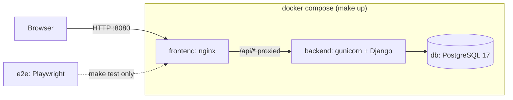
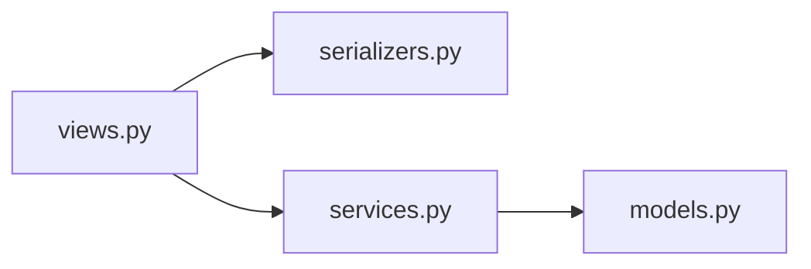

# Simple Job Management Dashboard

Create computational jobs, change their status, delete them. Django + PostgreSQL API, React +
TypeScript (Ant Design) UI, Playwright E2E tests, all in Docker.

- **Scope:** core requirements 1–5, plus one stretch goal (backend unit tests).
- **More reading:** [TRADEOFFS.md](TRADEOFFS.md) (why it is built this way) ·
  [NEXT_STEPS.md](NEXT_STEPS.md) (what is deferred) · [AI_chats/](AI_chats/) (AI transcripts).

## Quick start

Needs only `make`, `docker`, `docker compose` v2, `bash` and access to Docker Hub.

```bash
make test   # build everything, run the E2E tests, clean up
make up     # start the app, then open http://localhost:8080
```

## Commands

| Command | What it does |
|---|---|
| `make build` | Builds the backend and frontend images. |
| `make up` | Builds if needed, starts db + backend + frontend, waits until all are healthy. App at http://localhost:8080. |
| `make test` | Runs the Playwright E2E tests against a fresh, separate stack. Exit code is the tests' exit code. |
| `make stop` | Stops the app's containers. Data is kept. |
| `make clean` | Removes containers, networks and volumes of the app and both test stacks. |
| `make test-backend` | Extra: runs the backend unit tests (pytest) against a throwaway Postgres. |
| `make seed` | Extra: adds jobs to the running app. Default 1,000,000; `make seed N=5000`. Needs `make up` first. |
| `make help` | Lists the commands. |

Details:

- **`make up`**
  - Port 8080 busy? `FRONTEND_PORT=3000 make up`.
  - Migrations run when the backend container starts. No `.env` file is needed.
- **`make test`**
  - Works with no prior `make build`, and after a failed or interrupted run.
  - Uses its own compose project (`job-dashboard-test`) with no host ports, so it cannot clash
    with a running `make up` or a busy port, and never touches the app's data.
  - First run downloads Chromium and takes a few minutes; later runs take seconds.
  - On failure it prints the service logs before removing the stack.
- **`make stop`** then `make up` brings the same data back.
- **`make clean`** deletes the database volume. It is the "start from zero" command.

## Architecture



- `frontend` serves the built React app; `backend` is Django REST Framework under gunicorn.
- One origin: nginx serves the static files and proxies `/api/`, so there is no CORS setup.
- `make test` starts the same three services in a separate compose project, plus the `e2e` runner.

Inside the backend, one request passes through these layers:



- `views.py`: HTTP and error mapping. `serializers.py`: input validation.
- `services.py`: `create_job`, `change_status`, `delete_job`, one transaction each.
- `models.py`: `Job`, `JobStatus` and the database constraints.

## Where things are

```
Makefile                         the commands above
docker-compose.yml               db, backend, frontend, e2e (profile)
docker-compose.override.yml      host port, used by `make up` only
docker-compose.backend-test.yml  pytest runner, used by `make test-backend` only
backend/
  Dockerfile                     stages: base, test, runtime
  config/                        settings, root urls, health endpoint
  jobs/
    models.py                    Job, JobStatus, database constraints
    services.py                  the three writes, each in one transaction
    serializers.py  views.py  urls.py  pagination.py  exceptions.py
    management/commands/seed_jobs.py
    tests/                       unit tests (models, services, API, scale)
frontend/
  Dockerfile  nginx.conf         build with Node, serve with nginx
  src/api/                       fetch wrapper, run-time response checks, endpoints
  src/types/job.ts               Job, JobStatusType, Page<T>
  src/features/jobs/             page, table, form, row actions, hooks
e2e/
  tests/jobs.spec.ts             the two E2E flows
  tests/helpers.ts               locators and create-job helper
AI_chats/                        AI transcripts and design mockups
CLAUDE.md                        the plan and decision log the AI worked from
```

## Requirements map

| Brief | Where |
|---|---|
| 1. `Job`, `JobStatus` models | [backend/jobs/models.py](backend/jobs/models.py) |
| 1. REST API | [views.py](backend/jobs/views.py), [services.py](backend/jobs/services.py), [serializers.py](backend/jobs/serializers.py) |
| 2. List, create, update status, delete | [frontend/src/features/jobs/](frontend/src/features/jobs/) |
| 2. Error handling, validation | [api/client.ts](frontend/src/api/client.ts), [CreateJobForm.tsx](frontend/src/features/jobs/CreateJobForm.tsx), [errorCopy.json](frontend/src/features/jobs/errorCopy.json) |
| 3. Playwright E2E | [e2e/tests/jobs.spec.ts](e2e/tests/jobs.spec.ts) |
| 4. Dockerfiles, compose, Makefile | [backend/Dockerfile](backend/Dockerfile), [frontend/Dockerfile](frontend/Dockerfile), [docker-compose.yml](docker-compose.yml), [Makefile](Makefile) |
| 5. Performance | section below, [test_scale.py](backend/jobs/tests/test_scale.py) |
| Stretch: backend unit tests | [backend/jobs/tests/](backend/jobs/tests/) |

## API

| Method | Path | Body | Success | Errors |
|---|---|---|---|---|
| GET | `/api/jobs/?cursor=` | – | 200 `{next, previous, results}` (20 per page, newest first) | 404 bad cursor |
| POST | `/api/jobs/` | `{"name": "..."}` | 201, job starts `PENDING` | 400 bad name, 409 duplicate name |
| PATCH | `/api/jobs/<id>/` | `{"status_type": "RUNNING"}` | 200, appends a `JobStatus` row | 400 bad status, 404 |
| DELETE | `/api/jobs/<id>/` | – | 204, status rows deleted too | 404 |

- Statuses: `PENDING`, `RUNNING`, `COMPLETED`, `FAILED`.
- A job in a response: `id`, `name`, `current_status`, `created_at`, `updated_at`.
- Every error body has a stable `code`; the UI maps codes to its own text.

## Performance (millions of jobs)

- **No join to find the current status.** `Job.current_status` is written in the same
  transaction as each new `JobStatus` row, so the list is one query on one table.
- **Keyset (cursor) pagination, 20 rows per page.** Every page costs the same at any depth.
  `OFFSET` gets slower the deeper you go.
- **No `COUNT(*)`.** The UI has Previous / Next, not page numbers, so nothing counts the table.
- **Sorted by primary key** (`-id`), so the list needs no extra index.
- **Frontend:** only the 20 rows on screen are in the DOM; a status change re-renders one row.
- **Guarded by tests:** the list runs the same number of queries for 1 job or a full page, and
  its query plan must be an index scan with no sort ([test_scale.py](backend/jobs/tests/test_scale.py)).

Measured with 1,000,000 seeded jobs (Apple Silicon laptop, 2026-10-11):

| What | Result |
|---|---|
| Seeding 1M jobs + status rows | 29–45 s |
| 200 consecutive pages | median 1.4 ms, max 20 ms |
| A page from the middle (id < 500,000) | 4 ms |
| Query plan | `Index Scan Backward using jobs_job_pkey`, 0.03 ms |
| Next page in the browser, click to rows on screen | about 50 ms |

Try it: `make up && make seed`, then page through the UI.

## Tests

- **E2E** (`make test`): 2 tests. Create a job → listed as Pending → change to Running → still
  Running after a reload. Create a job → delete → gone.
- **Backend** (`make test-backend`): 170 tests on real Postgres: models and
  constraints, services (including rollback and concurrent writes), API, scale.

## Security notes

- **No authentication.** Not in the brief. Anyone who can reach the app can change jobs.
- **`make up` listens on all interfaces** and accepts any `Host` header, so it also works by IP
  on a remote VM. To tighten: `DJANGO_ALLOWED_HOSTS=localhost make up`.
- Details and the fix for each: [TRADEOFFS.md](TRADEOFFS.md), [NEXT_STEPS.md](NEXT_STEPS.md).

## Time spent

About 6 hours of build time across two days.

That includes learning and ramping time: I use Flask, MySQL and React for production apps at work. 
Django, PostgreSQL and Playwright is fairly new to me in a professional environment.

## AI usage

Built with Claude Code (Claude Opus). I directed, reviewed and committed; the AI never committed.

How I worked with it:

- **A written plan first.** [CLAUDE.md](CLAUDE.md) holds the scope, the priority order, a
  decision table and one section per phase. Each session started from it and updated it.
- **Small phases, one session each.** Gate first (walking skeleton), then data model, services,
  API, scale, design, frontend, E2E. Each phase ended with a manual check by me before the next.
- **Tests before code on the backend.** I reviewed test skeletons, then the plan, then the code.
- **Break-it checks.** For key guarantees I removed the code on purpose (the transaction, the
  row lock) and confirmed the matching test went red.
- **Code review as its own step.** A fresh session reviewed the backend without the context
  that wrote it; the frontend commit was reviewed before E2E started. I chose which findings
  to fix and which to defer.
- **Standing rules.** No fix before a priority order; an audit pass first; every deferred item
  gets a `TODO` in code and a stated reason.
- **Teaching by analogy.** Django, Postgres and Docker are new to me professionally, so I asked
  for explanations against the stack I use daily (Flask, MySQL, Elasticsearch).

Where I changed the AI's direction:

| What | Session |
|---|---|
| Stopped it building the backend during the skeleton phase | [02](AI_chats/chats/02-claude-md-phase-1-skeleton.md) |
| Chose unique job names over an idempotency-key column | [04](AI_chats/chats/04-phase-3-planning-and-test-cases.md) |
| Reverted a strict `ALLOWED_HOSTS` that would break reviewers on a VM | [07](AI_chats/chats/07-backend-code-review.md) |
| Picked the button menu over a `Select`, from the design mockups | [09](AI_chats/chats/09-frontend.md) |
| Kept the gate recipe untouched when offered trace export | [10](AI_chats/chats/10-phase-7-e2e.md) |

Transcripts. Edited before publishing, and only in these ways: email addresses, a second
account name, my local username and an account id appear as `REDACTED_…`; the company name
reads "the reviewer"; three screenshots I pasted are blanked; one tool output listing
unrelated projects is removed. The raw files hold the conversation records only (messages,
tool calls, tool results), without the app's bookkeeping records.

- Readable: [AI_chats/chats/](AI_chats/chats/), one Markdown file per session, in order.
- Raw: [AI_chats/sessions/](AI_chats/sessions/).
- Design mockups (Claude Design): [AI_chats/design/](AI_chats/design/).
