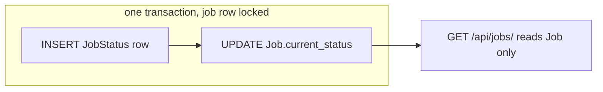

# Trade-offs

Three decisions shaped the project. Everything else is a smaller call, listed at the end.
The discussions are in [AI_chats/chats/](AI_chats/chats/).

## 1. Fast list vs one source of truth

The brief asks for each job's current status, with millions of jobs in mind.

- **Chose:** copy the current status onto `Job`, written in the same transaction as the new
  `JobStatus` row.
- **Instead of:** finding the latest `JobStatus` per job with a join or subquery on every list.
- **Why:** the list becomes one query on one table, served by the primary key.
- **Cost:** the status lives in two places. `services.py` keeps them in sync (one transaction,
  job row locked); the database does not enforce it. Tests cover rollback and concurrent writes.

## 2. Constant-cost paging vs page numbers

- **Chose:** cursor (keyset) pagination, 20 per page, newest first, Previous / Next in the UI.
- **Instead of:** page numbers with `OFFSET` and a `COUNT(*)` for the total.
- **Why:** `OFFSET` reads and discards every skipped row, and counting millions of rows is slow.
  A cursor page costs the same at any depth (measured: about 1–4 ms at 1M jobs).
- **Cost:** no "jump to page 500", no total count, and no sorting by other columns yet.

## 3. Duplicate-safe creates vs free naming

This one is my addition, not in the brief ([chat 04](AI_chats/chats/04-phase-3-planning-and-test-cases.md)).

- **Chose:** job names are unique, enforced by a database constraint; a duplicate gets a 409.
- **Instead of:** an idempotency key (a new column and header), or allowing duplicates.
- **Why:** if a create succeeds but the response is lost, the retry cannot make a second job.
  No extra column, and a clearer list for the user.
- **Cost:** two jobs can never share a name. Matching is exact, so `Job` and `job` are different.

## Smaller calls

- **PATCH only changes status and always appends a row**, as the brief describes. No rename.
- **Cascade delete is done by Django**, not the database; Django 5.2 cannot declare it on the key.
- **No authentication, any `Host` accepted.** Auth is not in the brief, and a strict host list
  breaks the app when opened by IP on a VM ([chat 07](AI_chats/chats/07-backend-code-review.md)).
- **No optimistic updates.** A row always shows what the server stored.
- **Status control is a button + menu**, not AntD `Select`: easier for screen readers and Playwright.
- **`make test` runs in its own stack with no host ports**, so a busy port cannot fail it.
- **Docker Hub images only**, so the e2e image installs Chromium itself.

The full decision table, with the reasoning for each, is in [CLAUDE.md](CLAUDE.md).
